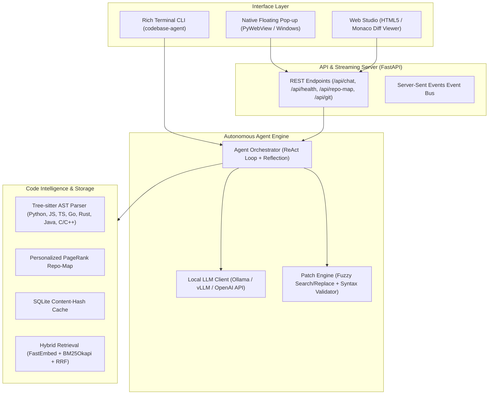

# ⚡ Codebase Intelligent Assistant

<p align="center">
  <strong>A private, local, agentic AI assistant designed to explore, understand, optimize, and edit codebases with native Git automation and a floating pop-up interface.</strong>
</p>

<p align="center">
  
  
  
  
  
  
</p>

---

## 🎯 What It Does

**Codebase Intelligent Assistant** is a 100% offline, free, and private pair-programming agent designed for local development. It runs entirely on your local machine using **Ollama** (e.g., Qwen 2.5 Coder 7B/14B/32B, DeepSeek Coder) or any OpenAI-compatible server (vLLM, LM Studio, llama.cpp).

Unlike basic read-only RAG chatbots, this assistant:
1. **Navigates your codebase** using Tree-sitter AST parsing and an architectural **PageRank Repository Map**.
2. **Performs hybrid semantic and lexical retrieval** (FastEmbed dense vectors + BM25Okapi + Reciprocal Rank Fusion).
3. **Actively edits code** using resilient Search/Replace blocks with whitespace-tolerant fuzzy matching and pre-flight syntax checks.
4. **Enforces human-in-the-loop review** via interactive side-by-side unified diff previews before touching files on disk.
5. **Executes Git operations** (`git status`, `git diff`, `git branch`, `git commit`, `git restore`).
6. **Operates in dual interface modes**:
   - 🪟 **Floating Desktop Pop-up Assistant** (native Windows/macOS/Linux overlay via PyWebView with always-on-top toggle).
   - 🌐 **Full Web Studio** (`http://127.0.0.1:8000`) with Monaco diff views, AST outlines, and Git staging panels.
   - 💻 **Rich Terminal CLI** (`codebase-agent chat`, `map`, `status`, `diff`, `index`).

---

## ✨ Feature Comparison

| Capability | Reference Repo | Codebase Intelligent Assistant |
|---|---|---|
| **Architecture** | Streamlit Read-Only Q&A | Async FastAPI + ReAct Agent Loop + PyWebView Floating Pop-up |
| **Code Editing & Patching** | ❌ None (Read-only) | ✅ Syntax-safe Search/Replace, Fuzzy Match & Instant Rollback |
| **Interactive Diff Review** | ❌ None | ✅ Visual Unified Diff Approval before modifying disk |
| **Git Operations** | ❌ None | ✅ Safe Git Status, Branching, Staging, Commit & Restore |
| **Repository Map** | Naive chunking | ✅ Tree-sitter AST Tags + Personalized PageRank Graph |
| **Multi-Language AST** | Legacy tree-sitter | ✅ Pre-compiled modular grammars (Python, JS, TS, Go, Rust, Java, C/C++) |
| **Hybrid Search** | ChromaDB + BM25 | ✅ ChromaDB + FastEmbed (CPU ONNX) + BM25 + Reciprocal Rank Fusion |
| **Delta Indexing** | In-memory | ✅ Persistent SQLite Content-Hash Cache (sub-second re-indexing) |
| **Call Graph Visualizer** | ❌ Roadmap | ✅ AST Caller-Callee graph export for Cytoscape.js |
| **Repository Comparison** | ❌ Roadmap | ✅ Semantic AST diff comparing branch/commit symbols |
| **Evaluation Harness** | ❌ Roadmap | ✅ Automated patch precision benchmark (`benchmarks/eval_editing.py`) |
| **Offline Privacy** | Cloud API fallback | ✅ 100% Offline, Zero Cloud Telemetry |

---

## 🏗️ System Architecture



---

## 🚀 Quick Start

### 1. Prerequisites
- **Python 3.10+**
- **Git**
- **Ollama** installed with your chosen model (e.g., `ollama pull qwen2.5-coder:7b`)

### 2. Setup Virtual Environment

```bash
# Clone the repository
git clone https://github.com/coep-dsai/codebase-intelligent-assistant.git
cd codebase-intelligent-assistant

# Create virtual environment
python -m venv .venv

# Activate on Windows:
.venv\Scripts\activate
# Activate on macOS / Linux:
source .venv/bin/activate
```

### 3. Install Dependencies

```bash
pip install -e ".[dev]"
```

### 4. Configuration

Copy the default environment configuration:

```bash
cp .env.example .env
```

Default settings in `.env`:
```ini
LLM_PROVIDER="ollama"
OLLAMA_BASE_URL="http://127.0.0.1:11434"
LLM_MODEL="qwen2.5-coder:7b"
EMBEDDING_PROVIDER="fastembed"
SERVER_HOST="127.0.0.1"
SERVER_PORT=8000
POPUP_ALWAYS_ON_TOP=true
REQUIRE_DIFF_CONFIRMATION=true
```

---

## 🖥️ Usage Modes

### Mode 1: Floating Pop-up Assistant
Launches a native, frameless or always-on-top floating window that sits alongside your code editor:

```bash
codebase-agent popup
```

### Mode 2: Web Studio
Starts the FastAPI server with the full browser dashboard:

```bash
codebase-agent serve
```
Open [http://127.0.0.1:8000](http://127.0.0.1:8000) in your browser.

### Mode 3: Interactive Terminal Chat

```bash
codebase-agent chat
```

### Mode 4: CLI Utilities

```bash
# Display the PageRank-ranked repository map
codebase-agent map

# Scan and incrementally update the AST cache
codebase-agent index

# Inspect Git status
codebase-agent status

# Perform AST semantic comparison against HEAD
codebase-agent diff --base HEAD
```

---

## 🧪 Testing & Evaluation

All features include complete unit and integration test coverage:

```bash
# Run pytest test suite
pytest

# Run the patch precision benchmark
python benchmarks/eval_editing.py
```

---

## 📂 Project Structure

```
codebase-intelligent-assistant/
├── benchmarks/
│   └── eval_editing.py            # Automated patch precision benchmark
├── docs/
│   ├── ARCHITECTURE.md            # In-depth architectural specification
│   └── CONTRIBUTING.md            # Team guide for new contributors
├── src/
│   ├── __init__.py
│   ├── cli.py                     # Typer CLI application
│   ├── config.py                  # Pydantic BaseSettings
│   ├── agent/
│   │   ├── llm_client.py          # Async Ollama & OpenAI local client
│   │   ├── orchestrator.py        # ReAct loop, tool runner & patch review
│   │   ├── prompts.py             # System prompts & OpenAI tool definitions
│   │   └── state.py               # Data models (ChatMessage, PendingPatch)
│   ├── analysis/
│   │   ├── call_graph.py          # Symbol call graph extractor
│   │   └── repo_diff.py           # AST-aware branch comparison
│   ├── editor/
│   │   ├── file_manager.py        # Path traversal guard & atomic writes
│   │   └── patch_engine.py        # Fuzzy search/replace & syntax check
│   ├── git_manager/
│   │   └── git_ops.py             # Git status, diff, branch, commit
│   ├── indexing/
│   │   ├── ast_parser.py          # Multi-language Tree-sitter extractor
│   │   ├── delta_indexer.py       # SQLite hash-based incremental cache
│   │   └── repo_map.py            # Personalized PageRank outline generator
│   ├── retrieval/
│   │   ├── bm25_search.py         # BM25Okapi lexical code retriever
│   │   ├── hybrid_search.py       # Reciprocal Rank Fusion (RRF)
│   │   └── vector_search.py       # ChromaDB + FastEmbed ONNX
│   ├── server/
│   │   ├── app.py                 # FastAPI application
│   │   ├── sse.py                 # Server-Sent Events handler
│   │   └── web_ui.py              # Embedded Web Studio & Pop-up UI
│   └── ui/
│       └── popup.py               # PyWebView Windows floating window
├── tests/                         # Comprehensive pytest test suite
│   ├── conftest.py
│   ├── test_api.py
│   ├── test_ast_parser.py
│   ├── test_bm25_search.py
│   ├── test_delta_indexer.py
│   ├── test_file_manager.py
│   ├── test_patch_engine.py
│   └── test_repo_map.py
├── pyproject.toml                 # PEP 621 build configuration
├── setup.py                       # Older pip compatibility shim
└── .env.example                   # Default configuration
```

---

## 👥 Contributing

Contributions are welcome! Please check out [CONTRIBUTING.md](docs/CONTRIBUTING.md) to learn how to add new language grammars, new agent tools, or expand the UI.

## 📄 License

MIT License. Free, open source, and offline forever.
